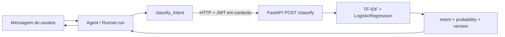

# TourShield - Implementação TP4

Helena Gomes e Maria Paula | 21/11/2026

## Continuidade e objetivo
Implementar roteamento de intenções do atendimento turístico e sua integração a um
agente. Mantidos app/, eda/, scripts/, tests/, data/, reports/ e output/pdf/. Os
notebooks TP1-TP3, as rotas legadas e os controles existentes foram preservados.
A versão passa a 0.4.0; o teste que verificava literalmente 0.3.0 acompanha a evolução.
Esta entrega cobre aplicação, testes funcionais e o complemento defensivo local
documentado em pentest/log_parcial.md.

## Dados e protocolo
Recorte CLINC150 existente: 20 intenções, 3.000 mensagens em inglês; 2.000 treino,
400 validação, 600 teste. Não houve tradução, troca de rótulos ou geração de dados.
O texto normalizado não contém duplicatas entre splits. Somente message entra no
modelo; intent, sample_id, split e comprimentos não são features.

Pipeline: TfidfVectorizer(lowercase=True, ngram_range=(1,2), max_features=10000,
sublinear_tf=True) e LogisticRegression L2, lbfgs, max_iter=2000. Grade min_df
{1,2,3} × C {0.1,1,10}. GridSearchCV com PredefinedSplit usa a validação já definida
no TP3 (um holdout, não múltiplos folds); métrica de seleção macro-F1. Vocabulary/IDF
são aprendidos em cada treino, nunca no teste. Refit da configuração vencedora em
2.400 exemplos antes da avaliação final de 600. O modelo inicial também é ajustado
nos mesmos 2.400 exemplos para a comparação final.

## Desempenho observado
Configuração vencedora: C=10 e min_df=1. Macro-F1 validação inicial 0,94949; ajustada
0,95741 (ganho de 0,7922 ponto percentual). No teste, macro-F1 inicial 0,92398 e
ajustada 0,93555 (ganho de 1,1575 ponto percentual), com 38 erros de 600 mensagens.
Baseline majoritária: acurácia 0,05, macro-F1 0,00476 e AUC 0,5; modelo final:
acurácia 0,93667 e AUC OvR macro 0,99807. Há aprendizado útil de associação texto/intenção
no benchmark. AUC alta não significa calibração perfeita ou capacidade de detectar fraude.

Limites: inglês, intenção única, benchmark balanceado, falta de exemplos desconhecidos.
O teste foi descrito na EDA anterior e não é um holdout externo totalmente intocado.
Probabilidade não calibrada não comprova elegibilidade, identidade ou geolocalização.

## Artefato e API
models/intent_classifier.joblib contém o pipeline completo, não apenas o classificador.
manifest.json registra versão, labels, SHA-256, versão de sklearn e hash dos dados.
O lifespan da API carrega o modelo. A recarga lê os bytes, verifica o hash e só então
desserializa o mesmo conteúdo. Hash e manifesto pressupõem origem confiável; não
aceitar artefatos enviados pelo usuário. Erros de carga mantêm rotas históricas e
fazem /classify responder 503 sem expor caminho ou stack trace.

ClassifyRequest herda StrictInput (extra=forbid). text é string estrita, não vazia,
até 4.000 caracteres. OAuth2PasswordBearer/current_user existentes autenticam o JWT.
O endpoint usa probabilidade máxima na ordem model.classes_, retorna intenção,
probabilidade e model_version. Não persiste texto, não concede benefícios ou reservas.

## Agente e integração
app/agent.py implementa Agent, instruções TourShield, @function_tool classify_intent
e Runner.run. A ferramenta envia POST /classify com o token apenas no contexto;
argumentos visíveis ao modelo contêm somente text. O cliente usa timeout, não segue
redirects e não herda proxy do ambiente. Falhas HTTP retornam mensagem genérica;
falhas do ciclo remoto não revelam exceções ao usuário.

O modo remoto requer OPENAI_API_KEY e OPENAI_MODEL. Não foi executado com provedor
remoto por ausência de credencial. scripts/demo_agent_tp4.py fornece Model determinístico
de demonstração: solicita a ferramenta, recebe sua resposta real e formata a fala.
Agent, Runner, chamada HTTP e inferência são reais; a decisão/geração do LLM é simulada.
Três turnos reais da demonstração estão em reports/tp4/agent_conversation.json e .md.

## Reprodução e evidências
Instalar requirements-lock.txt com Python 3.12. Para regenerar os resultados:

```powershell
python -m scripts.build_classification_notebook
python -m scripts.demo_classify_tp4
python -m scripts.demo_agent_tp4
pytest tests/ -v --junitxml=reports/tests_tp4.xml
python -m pip install -r requirements-report.txt
python -m scripts.build_report_tp4
```

O notebook é executável a partir da raiz do repositório, com data/ presente.
Os seis exemplos funcionais são HTTP de verdade em loopback, em banco temporário;
os testes ASGI usam a mesma app e banco isolado por teste. A suíte mantém a regressão
dos TPs anteriores e acrescenta 19 verificações/variações para TP4. Resultado atual:
66 testes aprovados na entrega inicial. O complemento defensivo acrescentou 19 casos,
com total atual de 85 aprovados, zero falhas ou erros, preservando o XML anterior.
O CI existente continua usando o mesmo check.

## Complemento de avaliação defensiva

Sete controles foram examinados a partir do código e de uma instância temporária da
mesma API: JWT, permissões/conta ativa, isolamento de reservas, função administrativa,
validação de parâmetros, inventário e respostas de erro. O harness
scripts/evaluate_defensive_tp4.py executou 44 verificações HTTP reais em loopback,
sem scanners ou alvos externos. Dados, senhas, tokens e banco são fictícios/descartáveis.

O log contém método, entrada, status/corpo efetivos, fonte e riscos. Evidência nova
em pentest/evidencias/defensiva_tp4/; JUnit em reports/tests_defensive_tp4.xml.
Não houve alteração no modelo ou na implementação dos controles para obter esses
resultados. Questões pendentes: revogação individual de JWT, quotas de inferência,
readiness operacional e avaliação de TLS/proxy/implantação. A aprovação dos casos
exercitados não implica ausência de vulnerabilidades em toda a aplicação.

## Fluxo


No modo de demonstração, a geração textual de A é determinística e identificada como
simulada. O restante do fluxo é executado. Não se afirma execução com LLM remoto.
