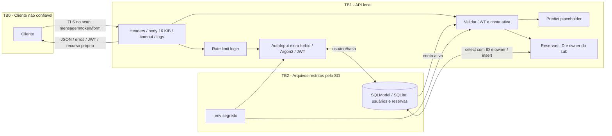

# Controles OWASP Top 10 - TP2

Esta matriz usa os IDs **2021** comuns na disciplina e indica a correspondência com
**2025**, edição atual. Controles reduzem riscos aplicáveis à API; não constituem
certificação nem promessa de proteção completa. ZAP passivo e pytest têm escopos diferentes.

| OWASP 2021 | Controles implementados / evidência | Limite e correspondência 2025 |
|---|---|---|
| A01 Broken Access Control | JWT obrigatório; GET /reservations/{id} consulta ID **e owner** autenticado; 404 igual para inexistente/outro usuário; owner nunca vem do body. Tests BOLA e sem token. | UUID não substitui autorização. A01:2025. |
| A02 Cryptographic Failures | Argon2id, JWT HS256 com chave externa, expiração/iss/aud/iat/sub; no-store; HSTS; auditoria real em TLS. | HTTP local é desenvolvimento; HSTS não cifra HTTP. Certificado válido/proxy TLS obrigatório em produção. A04:2025. |
| A03 Injection | SQLModel select/Session e expressões parametrizadas; nenhum SQL textual no código. Inputs Pydantic extra=forbid, limites, nenhuma execução de mensagem/URL. | Texto no destino é dado, nunca comando/HTML executado. A05:2025. |
| A04 Insecure Design | Ownership no servidor; status de reserva fixo requested; nenhuma aprovação de benefício; limite de body/timeout/login. | Recurso é demonstrativo; transação de resgate, idempotência e elegibilidade reais ficam para implementação futura. A06:2025. |
| A05 Security Misconfiguration | Middleware de headers; CORS allowlist; TrustedHost; debug false; Swagger/Redoc desativados; erros sem input/trace; uvicorn sem server-header e sem proxy-headers na execução orientada. | Nova origem/host exige configuração explícita e revisão. A02:2025. |
| A06 Vulnerable and Outdated Components | Versões diretas e transientes fixadas em requirements-lock.txt; relatório pip-audit em reports/dependency-audit.json. | Zero vulnerabilidades conhecidas no snapshot não impede novas CVEs; reauditar antes de implantar. A03:2025 (escopo ampliado). |
| A07 Identification and Authentication Failures | JWT validado, conta ativa verificada, senha não armazenada, erro genérico, hash dummy para usuário inexistente e 5 tentativas/IP/60s. | Sem MFA/refresh/revogação individual. Limiter é de processo único; reinício zera contagem, múltiplos workers exigem armazenamento compartilhado. A07:2025. |
| A08 Software and Data Integrity Failures | Hash/commit dos dados, lock de dependências, sem pickle/modelo carregado externamente; downloads ZAP/Java com hashes oficiais. | Assinatura de build e pipeline de release não implementados. A08:2025 e A03:2025. |
| A09 Security Logging and Monitoring Failures | Log JSON por resposta com request_id, método, rota canônica e status, inclusive 401/404/429/500. Teste garante ausência de senha/JWT/mensagem no log. | Coletor, retenção e alertas operacionais externos precisam de implantação; metadata permite contabilizar falhas. A09:2025. |
| A10 SSRF | A API não faz requests HTTP externos nem aceita URL de callback/ferramenta. destination e message não são dereferenciados. | Não aplicável como fluxo existente. Se houver integrações, usar destinos fixos e controle de egress. SSRF incluído em A01:2025. |

**A10:2025 (Mishandling of Exceptional Conditions):** falha de configuração impede startup;
validação retorna erro redigido; exceção inesperada gera 500 genérico com headers e evento
de auditoria, sem detalhes internos; timeout de leitura e body acima do limite recebem
408/413. Há teste de exceção, limite e falha de segredo.

## Rate limiting: decisão técnica

Janela deslizante de **5 requisições a /auth/token por IP em 60 segundos**, contabilizando
sucessos, falhas e bodies inválidos. A sexta recebe 429 e Retry-After; o limite é aplicado
antes do parsing e do custo do Argon2. Cinco tentativas acomodam erros de digitação em
uma demonstração local e reduzem tentativa automatizada e consumo de CPU. Não é valor
universal para produção: IP compartilhado pode causar bloqueio entre usuários; ataque
distribuído contorna limite por IP.

O estado tem Lock, deque e teto de 10.000 IPs ativos (falha fechada quando cheio), e usa
clock monotônico. Headers X-Forwarded-For são ignorados com `--no-proxy-headers`; se for
adicionado proxy, configurar somente proxies confiáveis e limiter compartilhado. Um
worker/processo é a configuração suportada neste TP; reinício limpa a memória.
Testes usam relógio injetável para recuperação de janela, sem sleep de 60 segundos.

## Headers e CORS

- Strict-Transport-Security: max-age=31536000; includeSubDomains.
- X-Frame-Options: DENY; X-Content-Type-Options: nosniff.
- Content-Security-Policy: default-src 'none'; frame-ancestors 'none'; base-uri 'none'; form-action 'none'.
- Cache-Control: no-store; Pragma: no-cache; Referrer-Policy: no-referrer.
- Permissions-Policy desativa geolocalização, câmera e microfone no contexto de navegador.
- X-Request-ID gerado pelo servidor; logs não adotam identificador arbitrário do cliente.
- CORS padrão: somente http://localhost:3000; métodos GET/POST; Authorization/Content-Type;
  allow_credentials=False (Bearer explícito, sem cookie de sessão).

Headers também aparecem em 401, 404, 422, 429 e erros. CORS controla leitura pelo navegador,
não é autorização nem proteção para clientes que não são browsers. /health é público;
/openapi.json expõe o contrato, sem credenciais. /docs e /redoc estão desativados porque
a CSP fechada não permite scripts externos/inline do Swagger padrão.

## DFD atualizado

CIA das reservas: destino é confidencial (token + owner + no-store); owner/status devem
ter integridade (campos definidos pelo servidor e SQLModel); disponibilidade é limitada
por SQLite local e limites de processo. Chave e banco continuam sujeitos às permissões
do sistema operacional, sem isolamento físico. A matriz CIA do TP1 permanece como histórico;
as pendências já resolvidas lá são substituídas por este documento.

Referências oficiais:
- https://owasp.org/Top10/2021/
- https://top10.owasp.org/2025/0x00_2025-Introduction/
- https://sqlmodel.tiangolo.com/tutorial/where/
- https://fastapi.tiangolo.com/tutorial/request-form-models/
- https://fastapi.tiangolo.com/tutorial/cors/
