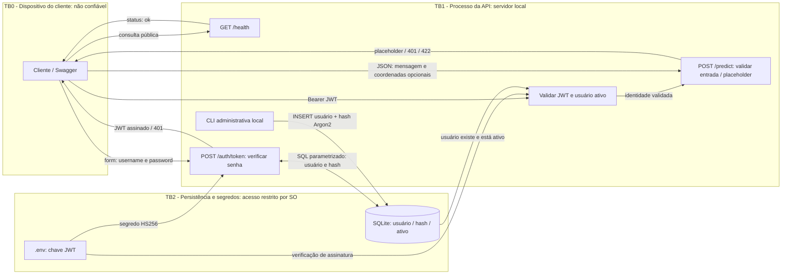

# DFD e análise CIA - TourShield API

## Fluxo atual (TP1)

TB0/TB1: qualquer dado do cliente é não confiável. Localmente o transporte é HTTP em loopback;
HTTPS é requisito antes de exposição externa, via proxy ainda não implementado.
TB1/TB2: fronteira lógica de permissões sobre arquivos, não isolamento físico.
SQLite, código e .env ficam na mesma máquina neste TP. CLI é processo administrativo
do operador com acesso ao arquivo do banco, não uma rota pública.
Dados de EDA são artefatos offline; a API não carrega CSV nem executa notebooks por requisição.

## Matriz CIA

| Componente | Confidencialidade | Integridade | Disponibilidade |
|---|---|---|---|
| Cliente/transporte | Senha, token, texto e GPS; HTTPS fora do loopback | Cliente pode mentir; validar campos e JWT | Timeouts e limitação no proxy são trabalho futuro |
| /health | Retorna apenas status e nome do serviço | Não recebe parâmetros nem expõe configuração | Sonda de vida pública; não garante prontidão do banco |
| /auth/token | Hash Argon2; senha não persistida; resposta no-store | SQL parametrizado; valida senha e conta ativa | Argon2 custa CPU; rate limiting distribuído ainda pendente |
| Validação JWT | Token é legível: só sub, iss, aud, iat e exp | HS256 fixo, assinatura, claims obrigatórias, emissor, público e expiração | Chave externa obrigatória; falha no startup sem configuração |
| /predict | Não persiste nem devolve texto ou GPS | Pydantic limita mensagem e coordenadas; extras rejeitados; identidade checada | Placeholder simples; limite global de corpo no proxy ainda pendente |
| SQLite/CLI | Apenas usuário/hash/ativo; restringir ACL do arquivo | Chave primária, transações, parâmetros, cadastro por CLI | Timeout de 5 s; backup e restauração a configurar |
| .env/chave | Excluído do Git, sem chave padrão; ACL do SO necessária | Segredo aleatório >=32 bytes; rotação pelo operador | Perda/rotação invalida tokens; guardar chave de forma protegida |
| Dataset/EDA | Benchmark público; evitar introduzir dados pessoais reais | Fonte fixada por commit, SHA-256 e bruto preservado | CSV presente para execução offline; cópia bruta versionada |

## Foco do tema: fraude de benefícios e geolocalização

JWT comprova uma sessão; não comprova elegibilidade para desconto, localização física
ou posse de uma reserva. Latitude/longitude são opcionais, validadas por intervalo e
sempre tratadas como declarações do cliente. Nenhuma precisão de localização é inferida.
O TP1 não decide fraude, não aprova resgate, não debita saldo e não efetua reserva.

Nos próximos TPs: manter saldo e elegibilidade no servidor; vincular reserva ao sub
do token; aplicar autorização por recurso para evitar BOLA/IDOR; usar transação e chave
de idempotência para impedir resgate duplicado; auditar resgates sem gravar token ou GPS
desnecessário; confrontar sinal geográfico com evidências independentes e consentidas.
Uma geofence isolada pode ser burlada por GPS falso e não deve decidir sozinha.
Mensagens também podem conter instruções maliciosas; em futuro agente, tratá-las como
dados e restringir ferramentas. Nenhum agente ou ferramenta externa existe nesta versão.

## Limites conhecidos

Sem rate limiting, revogação individual de JWT, MFA, TLS/proxy, backup automatizado,
monitoramento ou limite de bytes antes do parsing. Não apresentar como produção.
Desativar usuário bloqueia tokens já emitidos; rotação da chave invalida todos.
O projeto oferece testes funcionais de autenticação e validação, não uma auditoria completa.

Referência técnica: https://fastapi.tiangolo.com/tutorial/security/oauth2-jwt/
